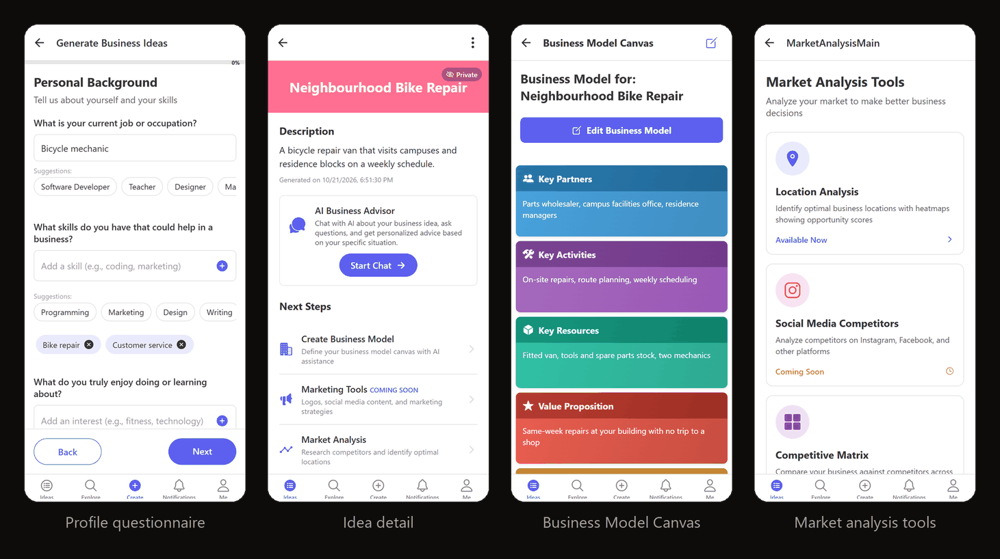
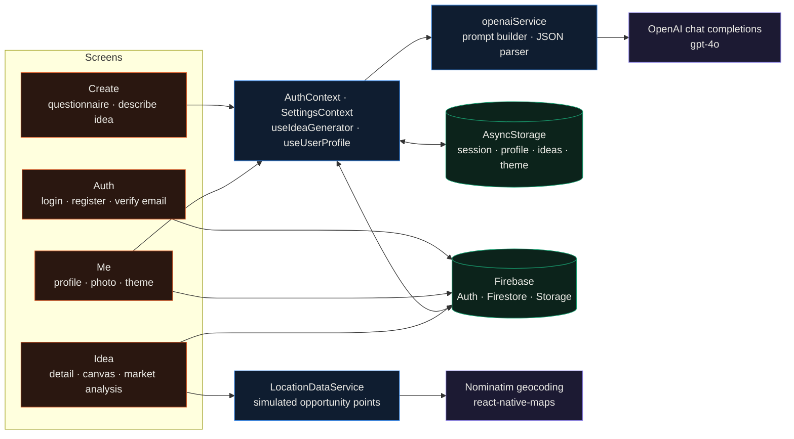
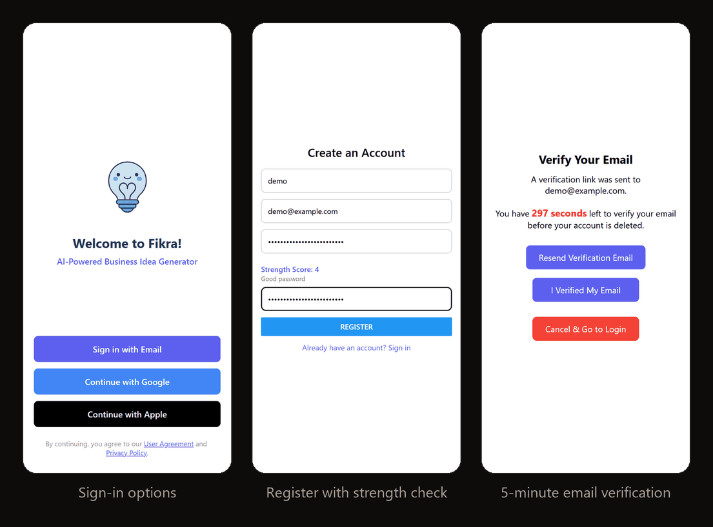
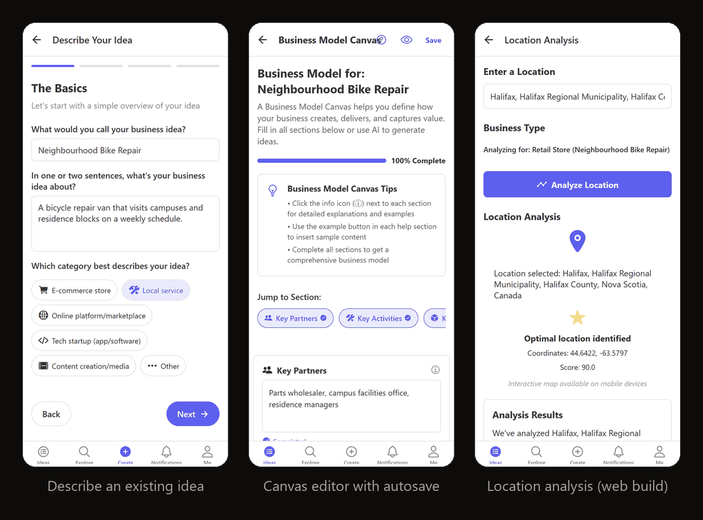
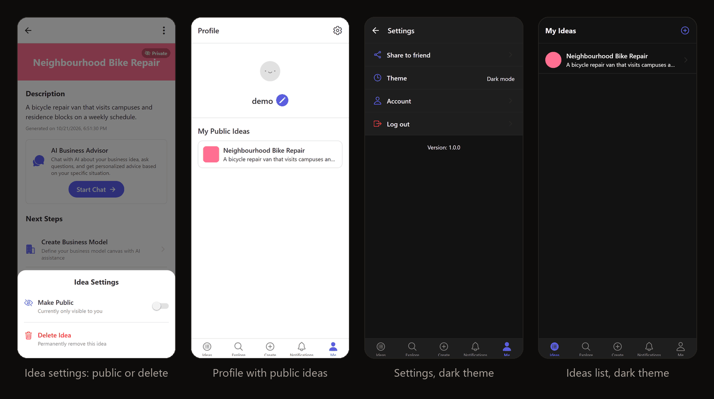

<div align="center">

# Fikra

**A React Native (Expo) app for first-time founders: a profile questionnaire goes to GPT-4o for business ideas, and each saved idea gets a Business Model Canvas and a location map.**




</div>

Fikra means "idea" in Arabic. You answer a questionnaire about your skills, budget, time and goals, GPT-4o
proposes five business ideas, and the one you keep gets a page with a Business Model Canvas, a location
opportunity map and a public/private switch for your profile. I built it as my CSCI 4176 course project, and it
is only partly complete: the competitor analysis tool, the full AI business advisor and the marketing tools were
planned but not finished, so they show up as placeholder or "coming soon" screens.

## Highlights

- The idea questionnaire has 8 sections with suggestion chips and a country/city picker. The answers become a structured prompt for OpenAI chat completions (`gpt-4o`, JSON response format, temperature 0.7, 1,500 max tokens) that asks for five ideas, each with a startup cost, time to market, profit potential and three key points.
- The response parser in `src/services/openaiService.js` handles several JSON shapes (`{businessIdeas: [...]}`, `{ideas: [...]}`, a bare array, a single object, numbered keys) and falls back to splitting plain text when the reply isn't JSON.
- Sign-up uses Firebase email/password auth with a zxcvbn check (score 3 of 4 required) and a 300-second email verification window. If the timer runs out, the app deletes the user's Firestore profile and signs them out.
- Ideas live at `users/{uid}/ideas/{id}` in Firestore. The nine-block Business Model Canvas autosaves 1.5 s after you stop typing and switches to a colour-coded read-only view once it has content.
- Reads are cache-first. The session, profile, ideas and theme are kept in AsyncStorage, so the app opens on the last known data and then refreshes from Firestore (the profile through a live snapshot listener).
- Location analysis geocodes a city (the device geocoder, falling back to OpenStreetMap Nominatim) and draws an opportunity map with react-native-maps: a Google Maps heatmap on Android and colour-coded markers on Apple Maps for iOS. The scores are simulated (see [Limitations](#limitations)).

---

## How it works



`src/App.js` wraps everything in an auth provider, a settings (theme) provider and a React Navigation container.
The root stack holds the five bottom tabs (Ideas, Explore, Create, Notifications, Me), the market analysis stack
and, depending on the Firebase user, either the auth screens or the email verification screen.

Idea generation runs entirely on the device. `CreateIdeaScreen` collects the answers, `useIdeaGenerator` calls
`openaiService.generateBusinessIdeas`, which posts to `/chat/completions` with the key from `.env`, and the
returned ideas open in a picker. The idea you choose is written to Firestore and to the AsyncStorage cache. The
"Describe your existing idea" path skips the model and saves a four-step form (basics, problem and audience,
solution, revenue) in the same format.

Storage layout:

| Where | What |
|---|---|
| Firestore `users/{uid}` | username, email, `createdAt`, verification flags, `theme`, `avatarUrl` |
| Firestore `users/{uid}/ideas/{id}` | idea fields, `isPublic`, `businessModel` (nine canvas blocks) |
| Storage `avatars/{uid}` | profile photo from the camera or gallery (`expo-image-picker`) |
| AsyncStorage | `user`, `@userProfile`, `@fikra_user_ideas_{uid}`, `@theme` |

## Screens

These come from the web build at a 390 × 844 viewport, signed in to a throwaway `demo` account on the Firebase
Local Emulator Suite. I typed the idea in through the "Describe your existing idea" flow. No OpenAI call was made,
so the generated-ideas picker isn't shown, and the web build shows a text summary where the phone shows the map.







## Quickstart

You need Node 18 or newer (I used Node 22), a Firebase project and an OpenAI API key.

```bash
git clone https://github.com/EllE961/Fikra.git
cd Fikra
npm install
cp .env.example .env        # fill in the Firebase and OpenAI values
npx expo start --web
```

`npx expo export --platform web` writes a static build to `dist/`. Without the Firebase values the app stops at
start-up with `auth/invalid-api-key` and renders a blank page.

## Configuration

Expo reads `.env` and inlines every `EXPO_PUBLIC_*` value into the JavaScript bundle. `src/constants/env.js`
collects them in one `ENV` object.

| Variable | Used for | Where to get it |
|---|---|---|
| `EXPO_PUBLIC_FIREBASE_API_KEY`, `_AUTH_DOMAIN`, `_PROJECT_ID`, `_STORAGE_BUCKET`, `_MESSAGING_SENDER_ID`, `_APP_ID` | `firebase.initializeApp` in `src/services/firebase/index.js` | Firebase console, Project settings, Your apps: register a Web app and copy its config |
| `EXPO_PUBLIC_FIREBASE_MEASUREMENT_ID` | read, but not passed to Firebase | same config block (optional) |
| `EXPO_PUBLIC_OPENAI_API_KEY` | idea generation | platform.openai.com, API keys |
| `EXPO_PUBLIC_OPENAI_API_URL` | chat completions base URL, defaults to `https://api.openai.com/v1` | change only for a compatible proxy |
| `EXPO_PUBLIC_GOOGLE_MAPS_API_KEY` | read into `ENV.MAPS`, but the map component doesn't use it | see the `app.json` note below |
| `EXPO_PUBLIC_SENTRY_DSN` | read, but Sentry is never initialised | optional |
| `EXPO_PUBLIC_ENV_NAME`, `EXPO_PUBLIC_API_BASE_URL` | only logged at start-up | leave as they are |

The Google Maps key that matters for native builds goes in `app.json`, in place of the two
`YOUR_GOOGLE_MAPS_API_KEY` placeholders (`ios.config.googleMapsApiKey` and `android.config.googleMaps.apiKey`).
Create it in the Google Cloud console with the Maps SDK for Android (and Maps SDK for iOS if you switch iOS to
Google Maps; it uses Apple Maps now).

In the Firebase project, turn on the Email/Password sign-in provider, create a Firestore database and enable
Storage for profile photos. The repo has no security rules. These owner-only Firestore rules cover everything
the app reads and writes; I ran the full sign-up, idea, canvas and profile flow against them on the emulator:

```text
rules_version = '2';
service cloud.firestore {
  match /databases/{database}/documents {
    match /users/{uid}/{document=**} {
      allow read, write: if request.auth != null && request.auth.uid == uid;
    }
  }
}
```

## Repository map

```text
src/
  index.js                 registers the app (and mounts it on web)
  App.js                   auth, settings and navigation providers, loading overlay
  constants/env.js         EXPO_PUBLIC_* configuration
  context/                 AuthContext (session + AsyncStorage), SettingsContext (theme), LoadingContext
  hooks/                   useIdeaGenerator (generate, save, cache ideas), useUserProfile
  navigation/              root stack, bottom tabs, ideas, market analysis and profile stacks
  screens/Auth/            login options, email login, register, email verification, password reset
  screens/Ideas/           questionnaire, describe idea, list, detail, canvas editor and view
  screens/MarketAnalysis/  tools hub, location analysis and the simulated heatmap data
  screens/Profile/         profile, edit profile with camera and gallery upload
  screens/Settings/        theme, account links, log out
  services/                Firebase compat SDK setup, OpenAI service, fetch wrapper
  components/              idea picker modal, loading overlay, password strength, map wrappers
docs/assets/               screenshots in this README
app.json                   Expo config with the Google Maps key placeholders
.env.example               environment template
report.pdf                 course completion report (April 2025)
```

## Limitations

- Unfinished features, as listed in `report.pdf`: competitor analysis (Social Media Competitors, Competitive Matrix and Industry Trends show "coming soon"), the AI business advisor ("Start Chat" opens a screen with only a title) and the marketing tools (a "coming soon" page). The Explore and Notifications tabs are placeholders, and the Google and Apple sign-in buttons only log a TODO.
- The location heatmap is simulated. Points come from hand-written street and district patterns for Halifax and Muscat, special cases for Los Angeles and New York, and a seeded generic pattern everywhere else, weighted by business type. No foot-traffic or competitor data is involved, and the "score" is the weight of the best generated point.
- The OpenAI key ends up in the client bundle and requests go straight from the device to OpenAI. That works for a demo; a public release would need a small server or cloud function in between.
- Only 13 of the questionnaire's 24 answers reach the prompt. Funding, runway, keeping your job, travel, industries to avoid, niche, adaptability, tools, network, obligations and other factors are collected but not sent.
- `refineBusinessIdea` and `generateKeywords` exist in `openaiService` but no screen calls them, and the canvas has no AI help even though its intro text mentions it.
- A signed-out user opens on the tabs rather than the login screen, because `MainTabs` is the first route in the root stack. The login screen is reached through Settings, Log out; generating or saving an idea while signed out only shows a sign-in alert.
- When the verification timer expires, only the Firestore profile is deleted; the Firebase Auth account stays (the delete call is commented out).
- The ideas list and profile read the AsyncStorage cache first and refresh it in the background, so a canvas edit or a public/private change shows up there on the next load. Writes go straight to Firestore; there is no offline write queue.
- On web, `Alert.alert` does nothing (react-native-web), so most success and error dialogs don't appear there. Camera capture and the map only exist in the native builds, which I last ran on Android for the course report.
- `expo-dev-client` is a dependency, so `npm start` expects a development build (`npx expo run:android` or `npx expo run:ios`). I didn't rebuild one for this README.
- There are no tests and no CI. A few unused files remain from earlier iterations: a two-factor screen with a mocked OTP, a Sentry error boundary, an older market analysis navigator that imports screens that don't exist, and a placeholder `CreateScreen`.

## License

MIT, see [LICENSE](LICENSE).
